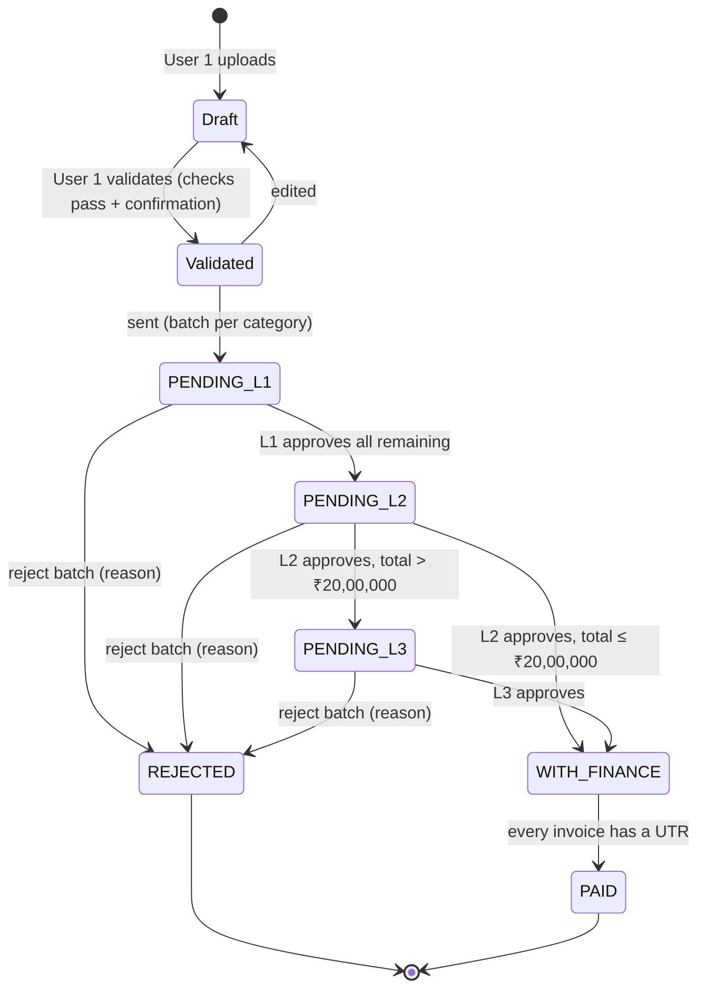

# Invoice Payment Approval System — IT handover and hosting guide

**Audience:** the company IT team rebuilding and hosting this system on company infrastructure.
**Business requirements:** see the BRD ("Invoice Payment Approval System — Business Requirements Document"). This file covers the *how*:

- the pilot's architecture and code
- the data model
- the rules the server must enforce
- the recommended target design
- migration and operations

| | |
|---|---|
| Pilot URL | https://mosaic-as.github.io/Payment-DashboardV2/ |
| Repository | https://github.com/Mosaic-as/Payment-DashboardV2 |
| Pilot stack | React 18 + TypeScript (Vite), Firebase Auth + Cloud Firestore, Google Drive / Sheets APIs, Google Apps Script mailer |
| Business owner | Finance / Accounts Payable |
| Status (Oct 2026) | Pilot live. Approvals and payments work; finance email set up but not yet confirmed (test email pending) |

---

## 1. What the system does (one paragraph)

1. **Upload and validate (User 1):** the user uploads warehouse vendor invoices, each with a PDF copy that is filed in Google Drive by service month. The system checks each invoice and the user validates it.
2. **Send:** User 1 sends the invoices for approval as **one batch per expense category**.
3. **Approve:** L1, then L2, approve each batch. Approvers can also approve or return single invoices.
4. **L3 above ₹20 lakh:** **L3 approves only when the batch total is more than ₹20,00,000**.
5. **Notify Finance:** on the final approval, Finance is emailed (from User 1's mailbox) with the batch Excel and all invoice PDFs attached.
6. **Pay:** Finance records a **UTR, payment date, TDS and amount paid for each invoice**, by hand or by Excel upload. The batch becomes **Paid** once every invoice has a UTR.

Every step is role-checked and recorded.

---

## 2. Pilot architecture

```
Browser (React SPA, GitHub Pages)
  ├── Firebase Auth (Google sign-in, domain-restricted)
  ├── Cloud Firestore (all data)  ← firestore.rules = the server-side authorisation
  ├── Google Drive API (user's own OAuth token) → invoice copies in month folders
  ├── Google Sheets API (user's own OAuth token) → register rewritten after each change
  └── Apps Script web app (deployed by User 1) → Gmail: finance email as User 1
```

There is **no application server** in the pilot. The business rules exist twice:

- **In the browser** (`src/lib/*`), for checks and a clear user experience.
- **In `firestore.rules`**, which Firestore enforces on the server. A user who bypasses the UI still can't break the workflow.

**For the rebuild, the rules in section 5 must move into your API.**

### Code map

| Path | What it contains | Re-usable on a server? |
|---|---|---|
| `src/config.ts` | Allowed domain, ₹20 L threshold, GST slabs, 16 expense categories, file size limit, Google IDs | Yes (move to server config) |
| `src/types.ts` | All entity types and status enums | Yes |
| `src/vendors.ts` | 79 starting vendors + `vendorKey()` duplicate matcher | Yes (seed data) |
| `src/lib/validation.ts` | Invoice validation (errors and warnings) | **Yes, pure TypeScript** |
| `src/lib/workflow.ts` | Routing (`nextStatusOnApprove`), batching (`planBatches`), stage derivation, batch number format, integrity check | **Yes, pure TypeScript** |
| `src/lib/payments.ts` | UTR template builder, Excel upload parser and checks | **Yes** (uses SheetJS) |
| `src/lib/excel.ts` | Excel and Sheet row builders (identical columns) | **Yes** (uses SheetJS) |
| `src/lib/financeMail.ts` | Finance email HTML body | **Yes** |
| `src/lib/format.ts` | ₹ formatting (Indian grouping), dates, Drive folder and file names | Yes |
| `src/lib/google.ts` | Drive / Sheets REST calls with the user's token | Re-implement with a service account |
| `src/data/actions.ts` | Every state change as a list of writes (save, validate, send, approve, return, reject, pay, settings) | Logic yes; becomes API handlers |
| `src/data/firebaseBackend.ts` / `demoBackend.ts` | Storage adapters (Firebase / browser-only demo) | Replace with an HTTP client to the new API |
| `src/data/store.tsx` | React state, live subscriptions, Sheet sync trigger | Front end only |
| `src/views/*`, `src/components/*` | Screens per role | Front end: keep |
| `firestore.rules` | **Authoritative permission and workflow rules** | Translate into API checks (section 5) |
| `rules-tests/rules.test.ts` | 15 tests running the real actions against the rules in the emulator | Port as API integration tests |
| `src/lib/*.test.ts` | 25 unit tests (routing, validation, UTR parsing, Excel, email body) | Keep |
| `apps-script/FinanceMailer.gs` | Pilot mailer (Apps Script, runs as User 1) | Replace with a server job (section 7) |

**Recommendation:** keep the React front end and the pure `src/lib` modules as they are. Run the same TypeScript on a Node.js API, so the validation and routing code isn't rewritten twice. If the company standard is Java or .NET, port `src/lib/workflow.ts`, `validation.ts` and `payments.ts` together with their unit tests, which act as the specification.

---

## 3. Workflow state machine



- **Batch statuses:** `PENDING_L1`, `PENDING_L2`, `PENDING_L3`, `WITH_FINANCE`, `PAID`, `REJECTED`. The UI shows `WITH_FINANCE` as "Partly paid (x/y)" when some invoices are paid.
- **Invoice stage** is *derived*, not stored:
  - `Draft` / `Validated`: from the invoice itself.
  - `Returned`: the batch was rejected, or the invoice is no longer in the batch's list (returned on its own).
  - `Paid`: the batch has a payment for that invoice.
  - Otherwise the batch's status.
- **Approving or returning single invoices** (within a level, the batch status doesn't change):
  - *Approve selected* adds IDs to `levelApproved`. When every remaining invoice is in `levelApproved`, the batch advances, and `levelApproved` is cleared for the next level.
  - *Return selected* removes IDs from `invoiceIds` and appends them to `returned` with the reason. It recalculates `taxableTotal`, `gstTotal`, `totalAmount` and `requiresL3`. It can't remove every invoice; that would be a whole-batch reject.
- **Final approval:** the transition into `WITH_FINANCE` triggers the finance email.

---

## 4. Data model

### 4.1 Pilot (Firestore documents)

```jsonc
// users/{email lower-case}
{ "name": "Arjun", "role": "approver1", "active": true }   // roles: maker, approver1, approver2, approver3, finance, admin

// vendors/{vendorKey}  — only vendors added in the app; 79 built-in in src/vendors.ts
{ "name": "Kalyan Movers", "gstin": "27ABCDE1234F1Z5", "createdBy": "...", "createdAt": "ISO" }

// invoices/{id}
{
  "vendorName": "Delhivery Limited", "vendorGstin": "", "invoiceNumber": "INV-1", "invoiceDate": "2026-10-01",
  "taxableAmount": 10000, "gstAmount": 1800, "totalAmount": 11800,
  "category": "Warehouse - Transportation", "serviceMonth": "2026-09", "notes": "",
  "dupKey": "delhivery limited|inv-1",
  "filePath": "<Drive file id>", "fileName": "2026-09 - Delhivery Limited - INV-1.pdf", "fileUrl": "https://drive.google.com/file/d/<id>/view",
  "status": "DRAFT | VALIDATED", "batchId": "<batch id> | null",
  "createdBy": "...", "createdAt": "ISO", "updatedAt": "ISO", "validatedBy": "... | null", "validatedAt": "ISO | null",
  "history": [{ "at": "ISO", "by": "...", "action": "Uploaded | Edited | Validated | Sent for approval", "note": "..." }]
}

// batches/{id}
{
  "batchNo": "B261024-ELEC-K1TK", "category": "Warehouse - Electricity",
  "invoiceIds": ["..."], "invoiceCount": 3, "taxableTotal": 60000, "gstTotal": 10800, "totalAmount": 70800,
  "requiresL3": false, "status": "PENDING_L1",
  "approvals": [{ "level": 1, "by": "...", "at": "ISO", "decision": "APPROVED | REJECTED", "comment": "" }],
  "levelApproved": ["<invoice id>"],
  "returned": [{ "invoiceId": "...", "invoiceNumber": "...", "vendorName": "...", "totalAmount": 0, "level": 1, "by": "...", "at": "ISO", "reason": "..." }],
  "payments": { "<invoice id>": { "utr": "SBIN426012345678", "date": "2026-10-23", "tds": 1000, "paid": 10800, "by": "...", "at": "ISO" } },
  "financeMail": { "status": "sent | failed", "at": "ISO", "by": "...", "parts": 1, "error": "..." },
  "createdBy": "...", "createdAt": "ISO", "updatedAt": "ISO", "paidAt": "ISO | null", "paidBy": "... | null"
}

// settings/mail
{ "to": ["payments@mosaicwellness.in"], "cc": ["cfo@mosaicwellness.in"], "mailerUrl": "https://script.google.com/macros/s/…/exec" }
```

### 4.2 Recommended relational schema (PostgreSQL 15+)

```sql
CREATE TYPE user_role    AS ENUM ('maker','approver1','approver2','approver3','finance','admin');
CREATE TYPE batch_status AS ENUM ('PENDING_L1','PENDING_L2','PENDING_L3','WITH_FINANCE','PAID','REJECTED');

CREATE TABLE app_user (
  email       citext PRIMARY KEY CHECK (email ~* '@mosaicwellness\.in$'),
  name        text NOT NULL,
  role        user_role NOT NULL,
  active      boolean NOT NULL DEFAULT true,
  created_at  timestamptz NOT NULL DEFAULT now()
);

CREATE TABLE expense_category (
  name   text PRIMARY KEY,               -- 'Warehouse - Electricity', …
  code   text NOT NULL UNIQUE,            -- 'ELEC' (batch number)
  active boolean NOT NULL DEFAULT true
);

CREATE TABLE vendor (
  id          bigserial PRIMARY KEY,
  name        text NOT NULL,
  match_key   text NOT NULL UNIQUE,      -- lower(name) without spaces/punctuation (vendorKey)
  gstin       text CHECK (gstin IS NULL OR gstin ~ '^\d{2}[A-Z]{5}\d{4}[A-Z][1-9A-Z]Z[0-9A-Z]$'),
  created_by  citext REFERENCES app_user(email),
  created_at  timestamptz NOT NULL DEFAULT now()
);

CREATE TABLE batch (
  id              uuid PRIMARY KEY DEFAULT gen_random_uuid(),
  batch_no        text NOT NULL UNIQUE,
  category        text NOT NULL REFERENCES expense_category(name),
  status          batch_status NOT NULL DEFAULT 'PENDING_L1',
  taxable_total   numeric(14,2) NOT NULL,
  gst_total       numeric(14,2) NOT NULL,
  total_amount    numeric(14,2) NOT NULL CHECK (total_amount > 0),
  requires_l3     boolean NOT NULL,     -- set by the server: total_amount > threshold
  created_by      citext NOT NULL REFERENCES app_user(email),
  created_at      timestamptz NOT NULL DEFAULT now(),
  paid_at         timestamptz,
  paid_by         citext REFERENCES app_user(email),
  version         integer NOT NULL DEFAULT 1   -- optimistic locking
);

CREATE TABLE invoice (
  id              uuid PRIMARY KEY DEFAULT gen_random_uuid(),
  vendor_id       bigint NOT NULL REFERENCES vendor(id),
  vendor_gstin    text,
  invoice_number  text NOT NULL,
  invoice_date    date NOT NULL,
  category        text NOT NULL REFERENCES expense_category(name),
  service_month   date NOT NULL CHECK (extract(day FROM service_month) = 1),
  taxable_amount  numeric(14,2) NOT NULL CHECK (taxable_amount >= 0),
  gst_amount      numeric(14,2) NOT NULL CHECK (gst_amount >= 0),
  total_amount    numeric(14,2) NOT NULL CHECK (total_amount > 0),
  CHECK (abs(taxable_amount + gst_amount - total_amount) <= 1),
  notes           text,
  drive_file_id   text NOT NULL,
  file_name       text NOT NULL,
  status          text NOT NULL CHECK (status IN ('DRAFT','VALIDATED')),
  batch_id        uuid REFERENCES batch(id),      -- current/last batch
  created_by      citext NOT NULL REFERENCES app_user(email),
  created_at      timestamptz NOT NULL DEFAULT now(),
  validated_by    citext REFERENCES app_user(email),
  validated_at    timestamptz,
  deleted_at      timestamptz,                    -- soft delete for never-sent drafts
  -- duplicate check, as makeDupKey(): invoice no. ignoring case and spaces, per vendor
  invoice_number_key text GENERATED ALWAYS AS (lower(regexp_replace(invoice_number, '\s', '', 'g'))) STORED,
  UNIQUE (vendor_id, invoice_number_key)
);

-- membership and per-level state of each invoice in a batch
CREATE TABLE batch_invoice (
  batch_id        uuid NOT NULL REFERENCES batch(id),
  invoice_id      uuid NOT NULL REFERENCES invoice(id),
  state           text NOT NULL DEFAULT 'IN_BATCH' CHECK (state IN ('IN_BATCH','RETURNED')),
  level_approved  boolean NOT NULL DEFAULT false,  -- approved one-by-one at the current level
  returned_level  smallint, returned_by citext REFERENCES app_user(email), returned_at timestamptz, return_reason text,
  PRIMARY KEY (batch_id, invoice_id)
);

CREATE TABLE approval (
  id          bigserial PRIMARY KEY,
  batch_id    uuid NOT NULL REFERENCES batch(id),
  level       smallint NOT NULL CHECK (level BETWEEN 1 AND 3),
  decision    text NOT NULL CHECK (decision IN ('APPROVED','REJECTED')),
  comment     text,
  by_user     citext NOT NULL REFERENCES app_user(email),
  at          timestamptz NOT NULL DEFAULT now(),
  CHECK (decision = 'APPROVED' OR length(trim(comment)) > 0)
);

CREATE TABLE payment (
  invoice_id  uuid PRIMARY KEY REFERENCES invoice(id),
  batch_id    uuid NOT NULL REFERENCES batch(id),
  utr         text NOT NULL CHECK (utr ~ '^[A-Z0-9]{12,22}$'),
  paid_on     date NOT NULL,
  tds         numeric(14,2) NOT NULL DEFAULT 0 CHECK (tds >= 0),
  amount_paid numeric(14,2) NOT NULL CHECK (amount_paid > 0),
  recorded_by citext NOT NULL REFERENCES app_user(email),
  recorded_at timestamptz NOT NULL DEFAULT now()
);

CREATE TABLE finance_mail (
  batch_id    uuid PRIMARY KEY REFERENCES batch(id),
  status      text NOT NULL CHECK (status IN ('QUEUED','SENT','FAILED')),
  parts       smallint, error text, requested_by citext, updated_at timestamptz NOT NULL DEFAULT now()
);

CREATE TABLE setting (key text PRIMARY KEY, value jsonb NOT NULL);   -- 'mail' → {"to":[…],"cc":[…]}, 'l3_threshold' → 2000000

CREATE TABLE audit_log (                                              -- append-only (revoke UPDATE/DELETE)
  id bigserial PRIMARY KEY, at timestamptz NOT NULL DEFAULT now(), actor citext NOT NULL,
  entity text NOT NULL, entity_id text NOT NULL, action text NOT NULL, before jsonb, after jsonb, ip inet
);
```

Store money as `numeric(14,2)`, never floating point, and round to paise exactly as `round2()` does.

---

## 5. Rules the server MUST enforce

These come from `firestore.rules` and `src/data/actions.ts`. Every one of them is covered by a test in `rules-tests/rules.test.ts`. Treat them as the acceptance tests for your API.

**Identity**
1. Accept only Google ID tokens with `hd = mosaicwellness.in`, `email_verified = true`, and the right audience.
2. The user must exist in `app_user` with `active = true`. Otherwise every call returns 403 (the UI shows "Access pending").

**Users and settings**
3. Only `admin` can create, update or delete users and change settings. An admin can't demote, disable or delete themselves.

**Invoices**
4. Only `maker` can create invoices. New invoices start in `DRAFT`. The amount check is |taxable + GST − total| ≤ 1, and the service month must be a valid month.
5. A maker can edit or validate an invoice only when it isn't locked. It is unlocked when it has no batch, its batch is `REJECTED`, or it was returned out of its batch. Any edit sets `status = DRAFT` and clears the validation.
6. Only the user in `validated_by` can send an invoice. It must be `VALIDATED` and not in an active batch.

**Sending**
7. **Sending:** the server groups the invoices by category and **recalculates the totals from the invoices**. It sets `requires_l3 = total > threshold`, using strictly greater than; the threshold is 2,000,000. Never accept totals or the L3 flag from the client.

**Approvals**
8. **Approval is allowed only to the role for the batch's current status:**
   - `PENDING_L1` → `approver1`
   - `PENDING_L2` → `approver2`
   - `PENDING_L3` → `approver3`

   Its next status follows `nextStatusOnApprove`:
   - L1 → L2.
   - L2 → L3 when `requires_l3`, else → `WITH_FINANCE`.
   - L3 → `WITH_FINANCE`.

   The approval history is append-only.
9. **Rejecting** needs a non-empty reason. It sets the status to `REJECTED`, and the invoices become editable by the maker.
10. **Approve selected** marks invoices `level_approved`. When all remaining invoices are approved, the batch transitions as in rule 8, and `level_approved` resets for the next level.
11. **Return selected** needs a reason, and can't return every invoice. It recalculates the totals and `requires_l3` on the server, and keeps the same status.

**Payments**
12. Only `finance` can record payments, only while the batch is `WITH_FINANCE`, and only for invoices in that batch. Corrections are allowed until the batch is `PAID`. When every invoice has a payment, set `PAID`, `paid_at` and `paid_by`, and lock the batch.
13. Payment validation (`checkPayment`):
    - UTR matches `^[A-Z0-9]{12,22}$`.
    - The payment date isn't in the future.
    - TDS ≥ 0 and amount paid > 0.
    - Paid + TDS ≤ total + ₹1.

**Records**
14. **Batches are never deleted.** Draft invoices that were never sent may be soft-deleted.
15. Write an `audit_log` row for every state change.

Use a transaction with `SELECT … FOR UPDATE` on the batch (or the `version` column) for approve, return and pay, so two approvers can't act on the same batch at once.

---

## 6. Recommended target architecture

```
Users' browsers ──HTTPS──► Reverse proxy (Nginx / company LB, TLS)
                              ├── /          → static React build (this repo's dist/)
                              └── /api/*     → API service (Node.js 22 LTS, e.g. NestJS/Fastify)
                                                 ├── PostgreSQL 15+ (primary + daily backup / PITR)
                                                 ├── Google OIDC (sign-in), Google Drive API (service account)
                                                 └── Job queue (pg-boss on PostgreSQL, or Redis/BullMQ)
                                                       └── Worker: finance email (Gmail API), Sheet sync, retries
```

- **Region:** host in India (the pilot's data is in `asia-south1`, Mumbai).
- **Sessions:** after OIDC sign-in, the API sets an HttpOnly, Secure, SameSite=Lax session cookie, valid for 8 hours. Add CSRF protection on mutating routes.
- **Files:** keep invoice copies in the existing **Google Drive** month folders. Use a Shared Drive and a service account, so no individual owns the files. The API streams uploads to Drive; the browser never needs Drive access.
- **Sheet sync:** a worker job, debounced by about 30 s after a change, rewrites the three tabs from the database. Same columns as `src/lib/excel.ts`.
- **Excel downloads:** the API generates them with the same `src/lib/excel.ts` / `payments.ts` code, or the front end keeps doing it from API data.

### 6.1 REST API (suggested)

| Method & path | Role | Purpose |
|---|---|---|
| `GET /api/me` | any active user | Current user and role |
| `GET /api/users` · `POST /api/users` · `PATCH /api/users/:email` · `DELETE /api/users/:email` | admin | User management |
| `GET /api/vendors` · `POST /api/vendors` | all · maker/admin | Vendor list; add a vendor (dedupe by `match_key`) |
| `GET /api/invoices?stage=&q=` | all | List with derived stage |
| `POST /api/invoices` (multipart: fields + file) | maker | Create draft; uploads to Drive `<root>/<YYYY-MM (Month YYYY)>/` |
| `PATCH /api/invoices/:id` (multipart) | maker | Edit (unlocked only); moves or renames the Drive file if the month, vendor or invoice no. changed |
| `POST /api/invoices/:id/validate` `{acknowledgedWarnings}` | maker | Server re-runs `validateInvoice`; 422 with errors |
| `DELETE /api/invoices/:id` | maker | Soft-delete a never-sent draft |
| `GET /api/invoices/:id/file` | all | Streams the copy from Drive (or a 302 to the Drive viewer) |
| `POST /api/batches` `{invoiceIds}` | maker | Creates one batch per category; returns the batches + Excel |
| `GET /api/batches?status=&category=` · `GET /api/batches/:id` | all | Register, detail with approvals/returns/payments |
| `POST /api/batches/:id/approve` `{comment}` | level approver | Approve all remaining |
| `POST /api/batches/:id/approve-invoices` `{invoiceIds, comment}` | level approver | Approve selected |
| `POST /api/batches/:id/return` `{invoiceIds, reason}` | level approver | Return selected |
| `POST /api/batches/:id/reject` `{reason}` | level approver | Reject whole batch |
| `POST /api/batches/:id/finance-mail` `{resend:true}` | L2/L3/finance/admin | Queue (re)send |
| `PUT /api/batches/:id/payments` `[{invoiceId, utr, date, tds, paid}]` | finance | Record or correct payments |
| `GET /api/payments/template.xlsx` | finance | UTR template (unpaid invoices) |
| `POST /api/payments/upload/preview` (xlsx) → `POST /api/payments/upload/commit` | finance | Bulk UTR: preview (ready/problems/warnings) then commit |
| `GET /api/reports/register.xlsx?…` | all | Excel exports |
| `GET /api/settings/mail` · `PUT /api/settings/mail` · `POST /api/settings/mail/test` | admin | Recipients; test email |

---

## 7. Finance email in the target design

- **Trigger:** the API transaction that moves a batch into `WITH_FINANCE` also inserts a `finance_mail` row with status `QUEUED` (an outbox pattern). The worker picks it up.
- **Send as User 1:** use the **Gmail API with domain-wide delegation**.
  1. Create a service account.
  2. The Workspace super admin authorises its client ID for scope `https://www.googleapis.com/auth/gmail.send`.
  3. The worker impersonates User 1's address. Keep that address in config, so a staff change is a config change.

  Alternative: send from a shared mailbox (`payments@…`) through the company SMTP relay.
- **Content:**
  - The HTML body comes from `src/lib/financeMail.ts`.
  - The subject is `Payment approved – <batch no> · <category> · ₹<total> · <n> invoices`.
  - Attach the batch Excel and each Drive file as `<Vendor> - <Invoice no>.<ext>`.
  - Keep each email at ≤ 17 MB of attachments. Overflow goes into "… – invoice copies part k of N" emails; the main body is never altered.
- **Retries:** retry 3× with backoff. Then set status `FAILED` with the error, and alert. The UI shows the status and offers **Resend**.
- **Reference implementation:** `apps-script/FinanceMailer.gs` already contains the exact packing and splitting logic.

---

## 8. Google Workspace configuration for the server

| Item | Purpose | Notes |
|---|---|---|
| OAuth client (Web) | Staff sign-in (OIDC) | Consent screen **Internal**; scopes `openid email profile`; redirect URI `https://<host>/api/auth/callback` |
| Service account + key (or workload identity) | Drive, Sheets, Gmail | Store the key in the company secrets manager, never in Git |
| Domain-wide delegation | Gmail send-as User 1 | Scope `gmail.send` only |
| Shared Drive "Finance - Invoices" | Invoice copies | Add the service account as Content manager; humans as Viewer/Editor as today |
| Google Sheet "Payment Register" | Live register | Share with the service account as Editor |
| APIs enabled | | Drive API, Sheets API, Gmail API |

Pilot IDs, which you can keep:

| Resource | ID |
|---|---|
| Firebase project | `payment-dashboard-51222` |
| Invoices folder | `1Y2TtTIZnKm5IENaJ-09ZUGxE1DLnawEW` |
| Register Sheet | `1JLAkXJX3zDVIe8yDOacfLof42aOpxtIqfUWFEnntnrU` |

---

## 9. Configuration (environment variables, target)

```dotenv
NODE_ENV=production
PUBLIC_URL=https://payments.mosaicwellness.in
DATABASE_URL=postgres://app:***@db:5432/payments
SESSION_SECRET=***
GOOGLE_CLIENT_ID=***.apps.googleusercontent.com
GOOGLE_CLIENT_SECRET=***
ALLOWED_DOMAIN=mosaicwellness.in
GOOGLE_SERVICE_ACCOUNT_KEY_FILE=/run/secrets/google-sa.json
DRIVE_ROOT_FOLDER_ID=1Y2TtTIZnKm5IENaJ-09ZUGxE1DLnawEW
REGISTER_SHEET_ID=1JLAkXJX3zDVIe8yDOacfLof42aOpxtIqfUWFEnntnrU
MAIL_SENDER=<User 1 email>           # impersonated via domain-wide delegation
L3_THRESHOLD_INR=2000000
MAX_ATTACHMENT_MB=10
```

---

## 10. Migration from the pilot

1. **Freeze:** announce a cut-over window. Put the pilot in read-only mode by publishing rules with `allow write: if false`.
2. **Export Firestore:** run `gcloud firestore export gs://<bucket>`, or a Node script using the Admin SDK that dumps `users`, `vendors`, `invoices`, `batches` and `settings` to JSON.
3. **Transform and load:**
   - `users` → `app_user`.
   - `src/vendors.ts` + `vendors` → `vendor`, deduplicated by `match_key`.
   - `invoices` → `invoice`, keeping `filePath` as `drive_file_id`.
   - `batches` → `batch`, `batch_invoice`, `approval` and `payment` (`returned[]` → `batch_invoice.state = RETURNED`; `levelApproved` → `level_approved`), plus `finance_mail`.
4. **Files:** nothing to copy. Drive files stay where they are; give the service account access to the folder.
5. **Reconcile:** compare counts and totals per batch status, and the payment sums, between the export and the database. Sign-off by Finance.
6. **Parallel run (recommended):** one month-end close on the new system with the pilot read-only for reference.

---

## 11. Deployment and operations

- **Containers:** `web` (Nginx serving `dist/`), `api`, `worker`, `postgres` (or managed). A minimal `docker compose` or Kubernetes manifests.
- **CI/CD:** on merge to `main`, run `npm ci`, `npm test`, the API tests, `npm run build`, then build images and deploy to staging, then production after approval. (The pilot uses `.github/workflows/deploy.yml` for GitHub Pages.)
- **Backups:** daily full backup plus WAL / point-in-time recovery for 30 days. Monthly restore test. Keep business data for **8 years**.
- **Monitoring:** health endpoints; alerts on 5xx rate, a `finance_mail` row `FAILED` or `QUEUED` for more than 10 min, Sheet sync failures, and backup failures.
- **Logs:** structured JSON. Never log invoice files or session tokens.
- **Security:**
  - Tooling: OWASP ASVS L2 checklist, dependency scanning (`npm audit`), TLS 1.2+.
  - Headers: CSP restricted to own origin + Google sign-in.
  - Attachment checks: PDF/JPEG/PNG ≤ 10 MB, MIME sniffed on the server.
  - Rate limits on sign-in and uploads.

---

## 12. Lessons from the pilot (please read)

- **Enforce rules on the server, recalculate totals on the server.** The pilot's batch-integrity check runs in the approver's browser; the rebuild fixes this.
- **Firestore rule limits caused a production defect.** Every approval was refused because a rule exceeded Firestore's 1,000-expression budget, and it wasn't visible until tested in the emulator. A conventional API removes this class of problem. Keep the integration tests.
- **Browser-driven side effects are fragile.** The Sheet sync and the finance email depend on someone's browser and pop-ups in the pilot. Move them to the worker with retries.
- **Sending as a person:** the Apps Script mailer is tied to User 1's Google account. Prefer domain-wide delegation, with the sender address in config.
- **Open item at hand-over:** the finance test email set up on 26 Oct 2026 had not arrived. Check the Apps Script deployment's executions log, "Who has access = Anyone", and the Settings URL.

---

## 13. Running the pilot locally

```bash
npm install
```

```bash
npm run dev
```

```bash
npm test
```

- **Demo mode:** with no `VITE_FIREBASE_*` variables set, the app runs in demo mode, with data kept in the browser and a role picker on the login page. Use `vite --mode demo`, which reads `.env.demo.local`.
- **Pilot settings:** the live settings are in `.env.example` / GitHub Actions variables (see the main `README.md`).
- **Rule tests:** `npm run test:rules` runs the 15 rule tests in the Firestore emulator. It needs Java 11+; on Windows, use `sh rules-tests/run.sh` with `JDK_DIR` set.
